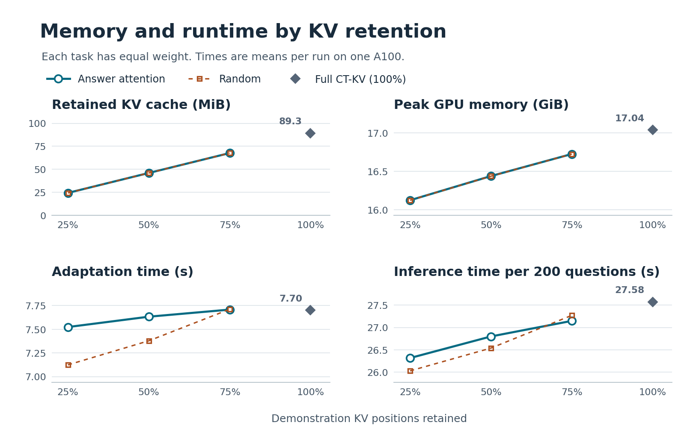

# BBH results on Llama 3 8B Instruct

Across 27 BBH tasks and five demonstration sets, full CT-KV raised strict accuracy from **49.13% to 56.38%** over standard ICL (+7.25 percentage points). [Phase 1 reconstruction](../phase1/README.md)

## How did we choose which KV entries to keep?

Our proposal asked whether we could retain the most useful demonstration tokens before CT-KV. We tested two ways to rank their positions. Both keep the highest-ranked positions in their original order and retain every instruction token.

- **`answer_attention`** ranks demonstration positions by the attention they receive during answer prediction. We mask each demonstration’s own cache entries in turn and measure attention to the other demonstrations while predicting its answer. Each position’s score is its mean attention across answer-prediction positions, heads and layers, giving each demonstration equal weight.
- **`value_norm`** is a comparison we chose because it can be computed directly from the cache. For each position, we measure the length (L2 norm) of its value vector in each KV head and layer, then average those lengths. Positions with longer value vectors on average rank higher. [Scoring code](../../../bbh_eval/ctkv.py#L61-L102)

At 50% retention and 16 CT-KV updates, `answer_attention` was correct on **294/480** development predictions (61.25%), versus **264/480** (55.00%) for `value_norm`. Accuracy decided the winner, with shorter adaptation time as the tiebreaker. We locked `answer_attention` for testing. We compared it with random selection at the same cache size. [Development decision](selection-8b.json)

## Does attention-based KV selection beat random selection?

On four tasks, `answer_attention` trailed equal-size random selection by **1.75 percentage points at 25% retention** and **0.92 at 50%**. At **75%**, both averaged **63.08%**. Attention won on two tasks and lost on two. Full CT-KV averaged **63.04%** on the same four tasks.


All three methods shown used 16 cache updates. Within each task, three demonstration sets shared 200 test questions. Phase 1 also evaluated these questions. [36 paired comparisons](paired_runs.csv)

## How much memory and time did compression save?

At 25% retention, the mean cache shrank from **89.32 to 24.36 MiB**. With attention selection, peak GPU memory fell from **17.04 to 16.13 GiB**. Preparing the cache took **7.52 s** with attention and **7.12 s** with random selection.



Costs are means across four equally weighted tasks. Adaptation includes cache construction, selection and optimization. Peak GPU is the maximum PyTorch allocation. Inference covers 200 questions per run. [Per-task means and standard deviations](task_summary.csv) · [Paired differences by task](paired_task_summary.csv)

<details>
<summary>Reproduce the four-task experiment</summary>

From the repository root in the Phase 1 environment, run

```bash
OUT="$(mktemp -d)"
python -m bbh_eval.experiment develop --project-model 8b --root "$OUT" --execute &&
python -m bbh_eval.experiment freeze --project-model 8b --root "$OUT" --execute &&
python -m bbh_eval.experiment project-test --project-model 8b --root "$OUT" --execute &&
python -m bbh_eval.summarize_llama_runs --root "$OUT/project-test/8b" --out "$OUT/project-summary"
```

</details>
