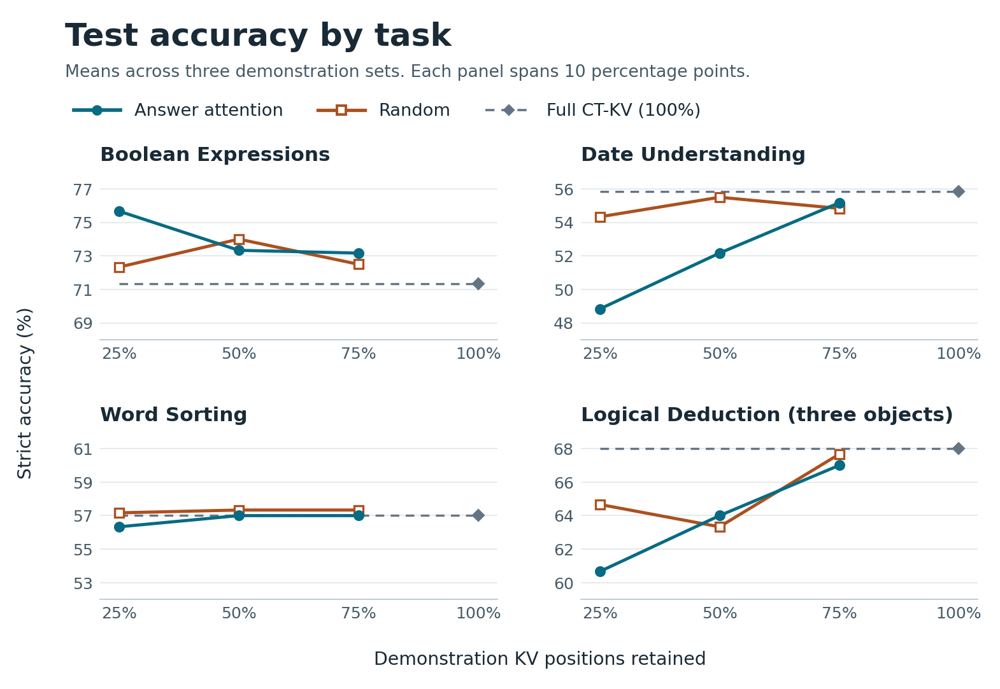

# BBH results on Llama 3 8B Instruct

Across 27 BBH tasks and five demonstration sets, full CT-KV raised strict accuracy from **49.13% to 56.38%** over standard ICL (+7.25 percentage points). [Phase 1 reconstruction](../phase1/README.md)

## How did we choose which KV entries to keep?

Our proposal asked whether we could retain the most useful demonstration tokens before CT-KV. We tested two ways to rank their positions. Both keep the highest-ranked positions in their original order and retain every instruction token.

- **`answer_attention`** ranks demonstration positions by the attention they receive during answer prediction. We mask each demonstration’s own cache entries in turn and measure attention to the other demonstrations while predicting its answer. Each position’s score is its mean attention across answer-prediction positions, heads and layers, giving each demonstration equal weight.
- **`value_norm`** is a comparison we chose because it can be computed directly from the cache. For each position, we measure the length (L2 norm) of its value vector in each KV head and layer, then average those lengths. Positions with longer value vectors on average rank higher. [Scoring code](../../../bbh_eval/ctkv.py#L61-L102)

At 50% retention and 16 CT-KV updates, `answer_attention` was correct on **294/480** development predictions (61.25%), versus **264/480** (55.00%) for `value_norm`. Accuracy decided the winner, with shorter adaptation time as the tiebreaker. We locked `answer_attention` for testing. We compared it with random selection at the same cache size. [Development decision](selection-8b.json)

## Does attention-based KV selection beat random selection?

After 16 CT-KV updates, attention-based selection showed no consistent accuracy advantage over random selection at the same retained cache size. Each task has equal weight. Differences use the unrounded paired scores.

| Demonstration tokens retained | Attention accuracy | Random accuracy | Attention − random |
|---|---:|---:|---:|
| 25% | 60.38% | 62.12% | −1.75 points |
| 50% | 61.62% | 62.54% | −0.92 points |
| 75% | 63.08% | 63.08% | 0.00 points |

At **25%**, the largest average gap favored random selection. Attention scored 3.33 points higher on Boolean Expressions and 5.50 points lower on Date Understanding. At **50%**, the average gap narrowed. Logical Deduction (three objects) was the only task where attention scored higher (+0.67 points). At **75%**, the four-task means tied. Attention led on Boolean Expressions and Date Understanding and trailed on Logical Deduction and Word Sorting. Both means were close to the original full CT-KV reference of 63.04% on these four tasks. [Differences by task](paired_task_summary.csv)



All three methods shown used 16 cache updates. Within each task, three demonstration sets shared 200 test questions. Phase 1 also evaluated these questions. [36 paired comparisons](paired_runs.csv)

## How much memory and time did compression save?

The two selection rules retained the same number of cache bytes at each budget. Peak GPU memory also matched to two decimal places. Paired times below are **attention / random**, in seconds.

| Demonstration tokens retained | Retained cache (MiB) | Peak GPU memory (GiB) | Adaptation (s) | Inference, 200 questions (s) |
|---|---:|---:|---:|---:|
| 25% | 24.36 | 16.13 | 7.52 / 7.12 | 26.32 / 26.03 |
| 50% | 46.01 | 16.44 | 7.63 / 7.38 | 26.80 / 26.54 |
| 75% | 67.65 | 16.73 | 7.71 / 7.71 | 27.15 / 27.27 |

At **25%**, the cache was about 73% smaller than the full cache (89.32 MiB), while peak GPU memory fell by about 5% from 17.04 GiB. At **50%**, attention took 0.25 s longer than random selection to prepare the same 46.01 MiB cache. At **75%**, the cache was still about 24% smaller than full. Preparing it took 7.71 s for either rule, close to 7.70 s for full CT-KV.


Costs are means across four equally weighted tasks. Adaptation includes cache construction, selection and optimization. Peak GPU is the maximum PyTorch allocation. Inference covers 200 questions per run. [Per-task means and standard deviations](task_summary.csv) · [Paired differences by task](paired_task_summary.csv)

<details>
<summary>Reproduce the four-task experiment</summary>

From the repository root in the Phase 1 environment, run

```bash
OUT="$(mktemp -d)"
python -m bbh_eval.experiment develop --project-model 8b --root "$OUT" --execute &&
python -m bbh_eval.experiment freeze --project-model 8b --root "$OUT" --execute &&
python -m bbh_eval.experiment project-test --project-model 8b --root "$OUT" --execute &&
python -m bbh_eval.summarize_llama_runs --root "$OUT/project-test/8b" --out "$OUT/project-summary"
```

</details>
