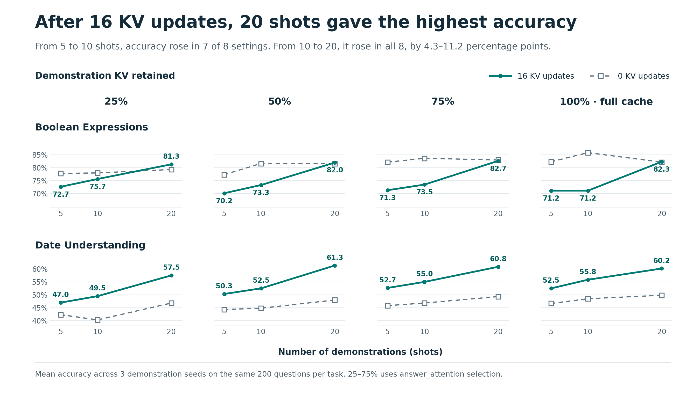

# BBH Follow-up Experiment (11/24)

**How does the number of demonstrations (5, 10, or 20) affect held-out accuracy on Boolean Expressions and Date Understanding?**

To measure the effect of shot count, we compared the same task, demonstration seed, test questions, KV retention percentage, and number of KV updates. We repeated this comparison at four retention levels (25%, 50%, 75%, and 100%) and at 0 and 16 updates to see whether the shot-count pattern changed with compression or tuning.

After 16 KV updates, increasing the demonstration count from 5 to 10 improved mean accuracy in seven of the eight task and retention combinations. Boolean Expressions with a full cache stayed at 71.17%. Increasing the count from 10 to 20 improved mean accuracy in all eight combinations, by 4.33 to 11.17 percentage points. At the same shot count and retention level, 16 updates improved Date accuracy in all 12 comparisons with zero updates. On Boolean, updates lowered accuracy at 5 and 10 shots. At 20 shots, their effect ranged from −0.33 to +2.00 percentage points.

## What we ran

We ran 144 configurations from scratch with Llama 3 8B Instruct on one A100-SXM4-80GB. Each task used the same 200 held-out questions throughout. For each of three demonstration seeds, the 5-shot set was the start of the 10-shot set, which was the start of the 20-shot set. We used answer_attention to retain 25%, 50%, or 75% of demonstration KV positions, kept the instruction prefix, and compared 0 versus 16 KV updates. At 100%, the corresponding baselines were Standard ICL and Full CT-KV.

## Accuracy by task

Read across a row to compare 5, 10, and 20 demonstrations. Each cell gives mean accuracy (%) across three demonstration seeds. Compare the left-hand values for 0 updates or the right-hand values for 16 updates.

| Task | KV retained | 5-shot | 10-shot | 20-shot |
| --- | ---: | ---: | ---: | ---: |
| Boolean | 25% | 77.83 → 72.67 | 78.00 → 75.67 | 79.33 → 81.33 |
| Boolean | 50% | 77.33 → 70.17 | 81.67 → 73.33 | 81.67 → 82.00 |
| Boolean | 75% | 82.17 → 71.33 | 83.67 → 73.50 | 83.00 → 82.67 |
| Boolean | 100% | 82.33 → 71.17 | 85.83 → 71.17 | 82.17 → 82.33 |
| Date | 25% | 42.33 → 47.00 | 40.33 → 49.50 | 46.83 → 57.50 |
| Date | 50% | 44.33 → 50.33 | 44.83 → 52.50 | 48.00 → 61.33 |
| Date | 75% | 45.83 → 52.67 | 46.83 → 55.00 | 49.33 → 60.83 |
| Date | 100% | 46.67 → 52.50 | 48.50 → 55.83 | 49.83 → 60.17 |



## Main findings

1. **Date gained from tuning in all 12 settings.** At 20-shot and 50% retention, tuning raised accuracy from 48.00% to 61.33% (+13.33 percentage points).
2. **Boolean responded differently.** At 10-shot with a full cache, tuning lowered accuracy from 85.83% to 71.17% (−14.67 points). At 20-shot, the effect across the four retention levels ranged from −0.33 to +2.00 points.
3. With 20 demonstrations and 16 KV updates, mean accuracy across Boolean Expressions and Date Understanding was 71.67% when retaining 50% of the demonstration KV cache and 71.25% when retaining the full cache, a difference of only 0.42 percentage points.

## Memory and time

20-shot, 16 updates. Each row averages the same two tasks and three seeds. Adaptation time includes KV selection where applicable.

| KV retained | Accuracy | KV cache (MiB) | Peak allocated GPU memory (GiB) | Adaptation (s) |
| ---: | ---: | ---: | ---: | ---: |
| 25% | 69.42% | 38.71 | 16.14 | 17.32 |
| 50% | 71.67% | 74.81 | 16.64 | 17.06 |
| 75% | 71.75% | 110.90 | 17.14 | 18.08 |
| 100% | 71.25% | 147.04 | 17.63 | 18.39 |

At 50% retention, the mean cache fell from 147.04 to 74.81 MiB. Peak GPU memory fell from 17.63 to 16.64 GiB, and mean adaptation time fell from 18.39 to 17.06 seconds.

## Source and results

The original GPU run produced 144 prediction files with 200 predictions each. The archive contains the per-question predictions, run metadata, logs, and environment records. The CSV files below are also available directly in this folder.

| File | Contents |
| --- | --- |
| [Original results archive](BBH_Attention_144_rqhxtTeN.tar.gz) | All 28,800 predictions and the original run records |
| [Shot comparisons](results/analysis-shots-two/shot_effects.csv) | Paired accuracy differences for 5, 10, and 20 shots |
| [Update and retention comparisons](results/analysis-shots-two/contrasts_per_task.csv) | Per-task differences for matched configurations |
| [Accuracy, memory, and time](results/analysis-shots-two/absolute_macro.csv) | Two-task means for all shot counts, retention levels, and update counts |
| [Run-level scores](results/analysis-shots-two/runs.csv) | Counts and metrics by task, seed, and configuration |
| [Experiment source](source/) | Original runner, split manifest, BBH data and license, and scoring and analysis scripts |
| [Figure source](figures/plot_shots.py) | Rebuilds the figure from the shot comparisons using Matplotlib |

To rerun the experiment on a compatible Linux GPU machine, start in this follow-up folder and run the following commands. See the [original run guide](source/README.md) for the pinned environment and model setup.

```bash
cd source
bash study.sh init && bash study.sh setup && bash study.sh access && bash study.sh precheck && bash study.sh start
```

To verify the code and data against the checksums saved by the GPU job without rerunning inference, execute this command from the follow-up folder on macOS or Linux.

```bash
tar -xOzf BBH_Attention_144_rqhxtTeN.tar.gz results/provenance/kit-sha256.txt | (cd source && shasum -a 256 -c -)
```
