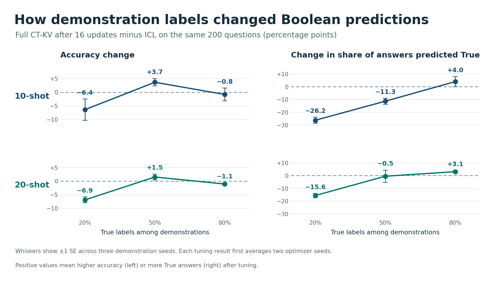
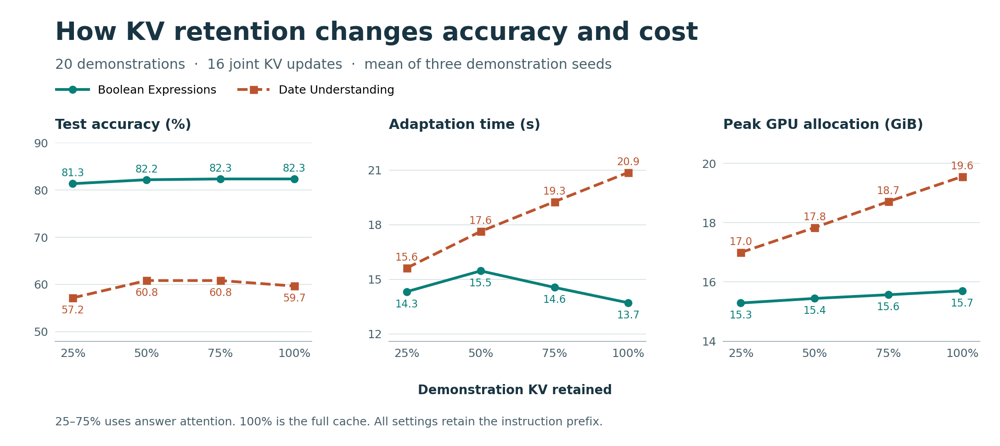
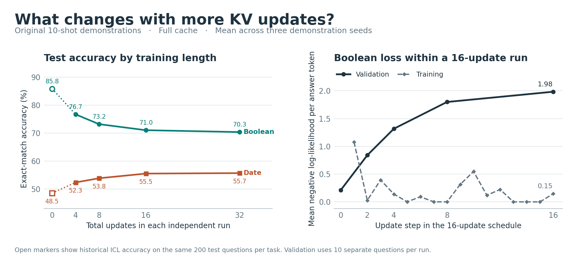

# BBH Follow-up Experiment (11/28)

**When does KV tuning help or hurt accuracy on Boolean Expressions and Date Understanding, and how much time and memory does it take?**

**November 28, 2026 · 180 completed runs · Boolean Expressions and Date Understanding**

We tested whether the accuracy drop on Boolean Expressions depends on which demonstrations the model sees, which KV tensors it updates, and how long it tunes. We also measured where CT-KV spends time and GPU memory.

We used **Llama 3 8B Instruct on one A100-SXM4-80GB**, with three demonstration seeds and the same 200 held-out test questions per task. The 180 runs produced 36,000 prediction records.

## Main insights

1. **Label balance changed whether tuning helped Boolean Expressions.** With 10 demonstrations, Full CT-KV lowered accuracy by **6.42 percentage points** when only two demonstrations were True. With five True and five False, tuning raised accuracy by **3.67 points**. Doubling the demonstrations while keeping the 20%-True ratio did not remove the drop.
2. **Which tensors received updates mattered, even at the same trainable parameter count.** On the original 10-shot Boolean prompts, Key-only scored **86.00%** and Value-only scored **71.50%**. Date Understanding showed the opposite preference, at **49.17%** and **55.50%**, respectively.
3. **Forward and backward passes accounted for 93.4% of adaptation time.** Updating only K or V halved gradient and optimizer-state memory, but adaptation still took about **17.4 seconds**. Retaining 25% of demonstration KV positions reduced adaptation time from **17.29 to 14.97 seconds**, with an accuracy trade-off that varied by task.
4. **The two tasks favored different training lengths.** On the original 10-shot prompts, Boolean test accuracy fell as the training schedule lengthened. Date improved through 16 updates and gained only **0.17 additional percentage points** at 32. This motivates testing whether validation performance can tell us when to stop.

## 1. How did demonstration label balance affect Boolean accuracy?

We compared Full CT-KV after 16 updates with Standard ICL on the **same ordered demonstrations and the same 200 questions**. Each cell shows the change in accuracy after tuning, averaged across three demonstration seeds. For each demonstration seed, we first averaged the two optimizer seeds.

| True labels among demonstrations | 10-shot change | 20-shot change |
|---|---:|---:|
| 20% True | −6.42 pp | −6.92 pp |
| 50% True | +3.67 pp | +1.50 pp |
| 80% True | −0.83 pp | −1.08 pp |

The test set contained **106 True and 94 False** answers throughout. With two True and eight False demonstrations, tuning reduced the share of test questions answered True from **64.00% to 37.75%**. Accuracy on questions whose correct answer was True fell from **94.03% to 63.21%**, while accuracy on False questions rose from **69.86% to 90.96%**.

The model became more likely to answer False, and the loss on True questions outweighed the gain on False questions. The shift was smaller in the opposite direction when 80% of demonstrations were True. In these runs, the direction of the imbalance mattered as well as its size.

## 2. Training Time Breakdown

The reference setting was **20 demonstrations, full cache, and 16 joint KV updates**. Each value is the mean across two tasks and three demonstration seeds, with all six runs weighted equally.

| Metric | Mean time | What it measures |
|---|---:|---|
| KV cache construction | 0.374 s | Building the full prefix cache from the instruction and demonstrations |
| Training forward passes | 6.300 s | Computing training loss across all 16 updates |
| Backward passes | 9.838 s | Computing gradients across all 16 updates |
| Optimizer stage | 0.161 s | Gradient clipping, Adam updates, and learning-rate scheduling |
| Average time per optimization step | 1.041 s | Directly timed update loop, including loop overhead |
| **Total adaptation time** | **17.288 s** | Cache construction, selection or index handling, training, and associated overhead |

**Backward was the largest measured component.** Forward and backward together took about **16.14 of 17.29 seconds**. The full-cache path spent another 0.025 seconds on selection and index handling. The per-step and total rows already include the training components above.

Model loading and test decoding fall outside the adaptation timer. Diagnostic validation used an additional **3.48 seconds** on average. A future early-stopping method would need to include its validation checks when reporting total time saved.

## 3. GPU Memory Breakdown

The reference setting is the same as in Section 2.

| Metric | Mean measurement | Scope |
|---|---:|---|
| Retained KV cache | 147.04 MiB | K and V tensors for the retained prefix, including the instruction |
| Activations saved for backward | 1,719.44 MiB | Unique floating-point storage saved by autograd in the first training microbatch, excluding model and prefix storage |
| Gradient memory | 147.04 MiB | Gradients of the trainable cache tensors at the first update |
| GPU optimizer state | 294.08 MiB | GPU-resident Adam state after the first update |
| **Peak allocated GPU memory during adaptation** | **17.63 GiB** | Peak allocation recorded by PyTorch, with diagnostic validation measured separately |

Activation coverage is partial. We also measured the largest increase in live allocations across a training forward pass, averaging **1,801.19 MiB**. That measure includes other allocations. The peak attributable specifically to activations over the entire training run remains unknown. The rows capture different points in training and cannot be added to reconstruct the GPU peak.

## 4. Scalability Analysis

### 4.1 How did cost change from 10 to 20 demonstrations?

These runs used the original prompts, the full cache, and 16 joint updates. Demonstration token counts exclude the instruction and are averaged across three seeds.

| Task | Shots | Mean demonstration tokens | Mean adaptation time |
|---|---:|---:|---:|
| Boolean Expressions | 10 | 160 | 7.20 s |
| Boolean Expressions | 20 | 320 | 13.71 s |
| Date Understanding | 10 | 1,000 | 8.54 s |
| Date Understanding | 20 | 1,990.67 | 20.87 s |

Date seed 0 used **992** tokens at 10 shots and **1,977** at 20 shots. The table gives the three-seed means.

At 20 shots, Date used over six times as many demonstration tokens as Boolean and took **20.87 seconds**, compared with **13.71 seconds** for Boolean. Within each task, increasing the shot count also increased the input length. A fixed-shot comparison of short and long prompts would help isolate the contribution of token length. The **5-shot** results belong to the earlier November 24 study.

### 4.2 What changed when we reduced the KV budget?

These are fresh results from the 180-run study. We used the original **20-shot prompts and 16 joint updates**. The retention percentage applies to demonstration KV positions. All instruction positions were retained.

**Mean across Boolean Expressions and Date Understanding, three seeds per task**

| Demonstration KV retained | Selection | Accuracy | KV cache | Peak GPU allocation | Adaptation time |
|---|---|---:|---:|---:|---:|
| 25% | Answer attention | 69.25% | 38.71 MiB | 16.14 GiB | 14.97 s |
| 50% | Answer attention | 71.50% | 74.81 MiB | 16.64 GiB | 16.54 s |
| 75% | Answer attention | 71.58% | 110.90 MiB | 17.14 GiB | 16.91 s |
| 100% | Full cache | 71.00% | 147.04 MiB | 17.63 GiB | 17.29 s |

**Date Understanding alone, three-seed mean**

| Demonstration KV retained | KV cache | Peak GPU allocation | Adaptation time | Saved activations in first microbatch | Test accuracy |
|---|---:|---:|---:|---:|---:|
| 25% | 64.92 MiB | 16.99 GiB | 15.62 s | 1,453 MiB | 57.17% |
| 50% | 127.13 MiB | 17.84 GiB | 17.63 s | 1,955 MiB | 60.83% |
| 75% | 189.29 MiB | 18.71 GiB | 19.26 s | 2,463 MiB | 60.83% |
| 100% | 251.58 MiB | 19.56 GiB | 20.87 s | 2,968 MiB | 59.67% |

On Date, **50% and 75% retention both averaged 60.83% accuracy**. The 50% condition used **62.17 MiB less cache** and took **1.63 seconds less** to adapt, based on unrounded means.

We also compared attention selection with random selection at the same retained cache size. At 25%, 50%, and 75% retention, **attention minus random** was **−0.50, −0.17, and −1.50 points** on Boolean. On Date, it was **−1.00, +3.50, and +3.17 points**. Each seed and budget had one random mask, so the results provide limited evidence about how these differences would vary across additional masks.

### 4.3 How did Full KV, Key-only, and Value-only compare?

The three tuned methods used the same original prompts, full cache, 16 updates, and optimizer seed. ICL is the matched historical zero-update reference.

| Task | Shots | Standard ICL | Full KV | Key-only | Value-only |
|---|---:|---:|---:|---:|---:|
| Boolean Expressions | 10 | 85.83% | 71.00% | 86.00% | 71.50% |
| Boolean Expressions | 20 | 82.17% | 82.33% | 82.67% | 82.67% |
| Date Understanding | 10 | 48.50% | 55.50% | 49.17% | 55.50% |
| Date Understanding | 20 | 49.83% | 59.67% | 49.67% | 60.17% |

On **10-shot Date**, Value-only matched Full KV accuracy at **55.50%**. Updating either K or V alone reduced gradients plus GPU Adam state from **383.25 to 191.63 MiB**, but peak GPU allocation fell only from **17.85 to 17.65 GiB**. Adaptation took **8.54 s** for Full KV, **8.45 s** for Key-only, and **8.43 s** for Value-only.

At **20 shots across both tasks**, each single-tensor method still stored the full **147.04 MiB** cache. Gradients and optimizer-state memory halved, but mean adaptation time was **17.43 s for Key-only**, **17.46 s for Value-only**, and **17.29 s for Full KV**. The reduction in trainable parameters produced a measurable memory saving and no observed average speedup in this setting.

## 5. Convergence Analysis

**As CT-KV continues updating the cache, does it keep getting better at answering new questions?** We examined this in two ways. First, we checked validation performance during the same training run. Second, we compared the test accuracy of separate runs trained for different numbers of updates.

### 5.1 What happened during a single training run?

We logged training loss at every update. We also evaluated **ten separate validation questions** at steps 0, 2, 4, 8, and 16 when reached, plus the endpoint for a 32-step run. The table shows the three-seed mean for the original **10-shot Boolean prompts on a 16-step schedule**.

| Step | Training NLL used for the update | Validation NLL after the update | Validation accuracy |
|---:|---:|---:|---:|
| 0 | — | 0.212 | 86.67% |
| 2 | 0.02851 | 0.841 | 70.00% |
| 4 | 0.14112 | 1.318 | 70.00% |
| 8 | 0.00053 | 1.799 | 66.67% |
| 16 | 0.14762 | 1.984 | 66.67% |

**What is negative log-likelihood (NLL)?** NLL measures how much probability the model assigns to the correct answer. For one correct answer token with probability `p`, the loss is `−ln(p)`. If the correct token is `True`, assigning it 90% probability gives a loss of **0.105**. Assigning it 60% probability gives a loss of **0.511**. The model can answer correctly both times, while NLL shows that its confidence in the correct answer fell. For answers with multiple tokens, we score each correct next token and average over the answer tokens. **Lower NLL is better.**

**Why use it here?** Validation accuracy stayed at **66.67%** between steps 8 and 16, while validation NLL rose from **1.799 to 1.984**. The number of correct answers stayed the same, but the model’s probability scores for the correct tokens worsened overall. At step 8, training NLL was already near zero at **0.00053**. The model had become very good at predicting the demonstration answers while its performance on unseen questions had deteriorated.

### 5.2 How many updates helped on the test questions?

Each column gives mean accuracy on the same **200 test questions per task**. The 0-step column is the earlier matched ICL reference. The other columns are fresh, independent runs. Each training length used its own cosine learning-rate schedule, so a run designed to end at step 4 can produce a different result from checkpoint 4 of a 16-step run.

| Task, original 10-shot prompts | 0 updates, ICL | 4 updates | 8 updates | 16 updates | 32 updates |
|---|---:|---:|---:|---:|---:|
| Boolean Expressions | 85.83% | 76.67% | 73.17% | 71.00% | 70.33% |
| Date Understanding | 48.50% | 52.33% | 53.83% | 55.50% | 55.67% |

- **Boolean Expressions.** The historical 0-step reference had the highest accuracy on the original 10-shot prompts. This conclusion depends on the demonstrations. In the separate label-balanced experiment in Section 1, tuning improved accuracy.
- **Date Understanding.** Going from 0 to 16 updates improved accuracy by **7.00 percentage points**. Going from 16 to 32 added only **0.17 points**. Sixteen steps came close to the best observed accuracy, although the experiment did not establish a minimum number of steps required to reach a predefined target.

### 5.3 Could validation NLL help us decide when to stop?

After all four training schedules finished, we chose the one with the lowest final validation NLL separately for each demonstration seed. The candidates were **4, 8, 16, and 32 updates**.

| Task | Updates selected for seeds 0 / 1 / 2 | Mean test accuracy change versus always using 16 |
|---|---|---:|
| Boolean Expressions | 4 / 4 / 4 | +5.67 pp |
| Date Understanding | 16 / 8 / 16 | −0.50 pp |

Zero steps was outside the candidate set, even though the historical ICL reference performed best on the original Boolean prompts. These results make validation NLL worth testing as a stopping signal. Because all schedules had already run, **actual time savings from stopping early remain unmeasured**.

## Limitations

- **Two tasks and three demonstration seeds.** The controlled Boolean label-ratio experiment used two optimizer seeds per tuned condition. The original-prompt comparisons used one optimizer seed. Random compression used one mask per seed and budget.
- **Previously examined test questions.** All runs used the same 200 test questions per task. This supports paired comparisons, but a new method developed from these observations needs a fresh evaluation.
- **Shot count and token length changed together.** This study profiled 10 and 20 shots. The earlier 5-shot study does not provide a directly matched breakdown with the same instrumentation.
- **Partial activation measurement.** The saved-tensor probe covers the first training microbatch. We measured peak GPU allocation over adaptation, but the activation-only share of that peak remains unknown.
- **Ten validation questions per run.** A single changed answer moves an individual run’s validation accuracy by ten percentage points. NLL gives a finer-grained signal, but the validation set is still small.
- **The minimum useful number of steps remains open.** We tested discrete training lengths with different schedules. The answer also depends on the task, the demonstrations, and how much accuracy loss is acceptable.

## Next steps

1. **Test a stopping rule during training.** Define an acceptable accuracy loss in advance. Compare fixed 16 updates with a rule that can stop at **0, 2, 4, 8, or 16** on a common learning-rate schedule. Choose the rule on development data, use separate validation questions for stopping, and score on fresh test questions. Report accuracy, actual steps taken, and total time including validation.
2. **Test demonstration selection beyond label balance.** On Boolean, compare **uniform random sampling**, **label-balanced random sampling**, and **label-balanced sampling that covers different operators and nesting depths**. Match shot count, order policy, and approximate token length. Measure accuracy before tuning and after 16 updates to see whether better examples improve the starting prompt, the benefit of tuning, or both.
3. **Isolate token length and check the memory trend.** At a fixed shot count and label mix, compare shorter and longer demonstrations within the same task. Measure saved activations across multiple microbatches. Add a matched 5-shot condition if the goal is to compare 5, 10, and 20 shots with the same profiling setup.

## Evidence

English [experiment archive](https://github.com/lvelf/ct-kv-compression/blob/eval/bbh/results/bbh_llama3_8b/tuning_mechanisms_2026-11-28/BBH_Mechanisms_2026-11-28_EN.tar.gz) and [SHA-256 checksum](https://github.com/lvelf/ct-kv-compression/blob/eval/bbh/results/bbh_llama3_8b/tuning_mechanisms_2026-11-28/BBH_Mechanisms_2026-11-28_EN.tar.gz.sha256). The archive contains all 180 formal runs. The English edition changes the run guide and its checksum entry. All other archived files match the GPU export byte for byte. The original GPU export had SHA-256 `c0e9e6c306abc62a0cfe888ad4ed16b1f7f2aad47063ef12687562c3799096f5`.

The following files are under [`results/analysis/`](https://github.com/lvelf/ct-kv-compression/tree/eval/bbh/results/bbh_llama3_8b/tuning_mechanisms_2026-11-28/results/analysis).

| Question | Evidence file |
|---|---|
| How did accuracy change within matched conditions and seeds? | [`paired_summary.csv`](https://github.com/lvelf/ct-kv-compression/blob/eval/bbh/results/bbh_llama3_8b/tuning_mechanisms_2026-11-28/results/analysis/paired_summary.csv), [`paired_by_seed.csv`](https://github.com/lvelf/ct-kv-compression/blob/eval/bbh/results/bbh_llama3_8b/tuning_mechanisms_2026-11-28/results/analysis/paired_by_seed.csv) |
| How did time, memory, and token counts change? | [`resource_profiles.csv`](https://github.com/lvelf/ct-kv-compression/blob/eval/bbh/results/bbh_llama3_8b/tuning_mechanisms_2026-11-28/results/analysis/resource_profiles.csv) |
| How did training loss and validation performance evolve? | [`training_loss.csv`](https://github.com/lvelf/ct-kv-compression/blob/eval/bbh/results/bbh_llama3_8b/tuning_mechanisms_2026-11-28/results/analysis/training_loss.csv), [`validation_checkpoints.csv`](https://github.com/lvelf/ct-kv-compression/blob/eval/bbh/results/bbh_llama3_8b/tuning_mechanisms_2026-11-28/results/analysis/validation_checkpoints.csv) |
| Which training length did validation NLL select? | [`validation_horizon_selection.csv`](https://github.com/lvelf/ct-kv-compression/blob/eval/bbh/results/bbh_llama3_8b/tuning_mechanisms_2026-11-28/results/analysis/validation_horizon_selection.csv) |
| Which comparisons used earlier matched runs? | [`historical_checks.csv`](https://github.com/lvelf/ct-kv-compression/blob/eval/bbh/results/bbh_llama3_8b/tuning_mechanisms_2026-11-28/results/analysis/historical_checks.csv) |
